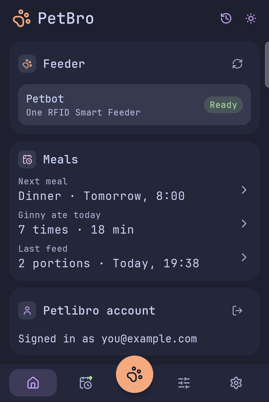
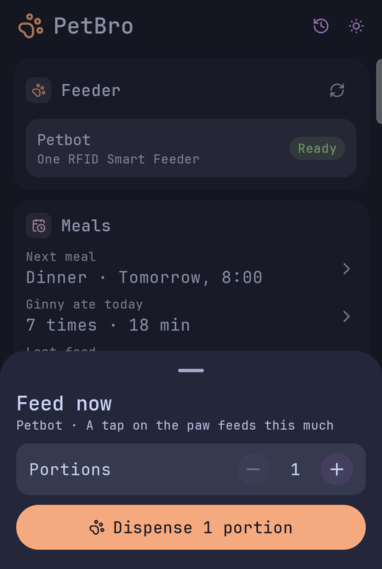
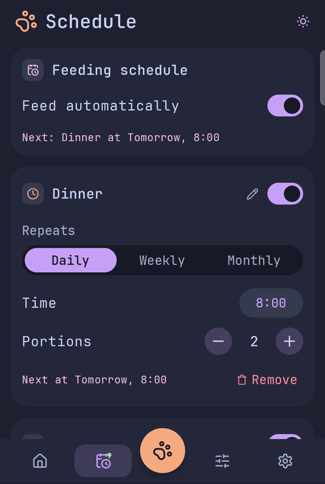
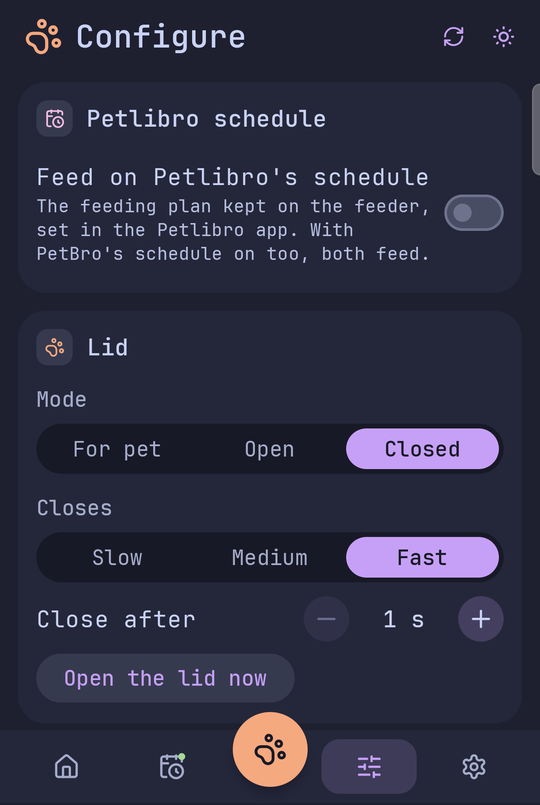
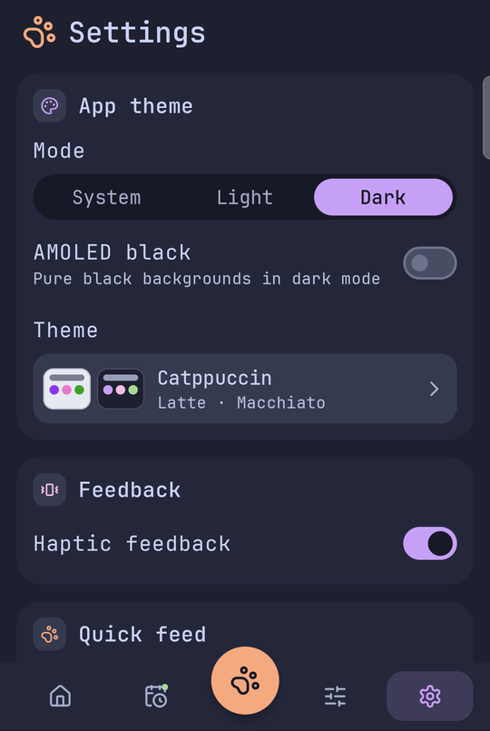
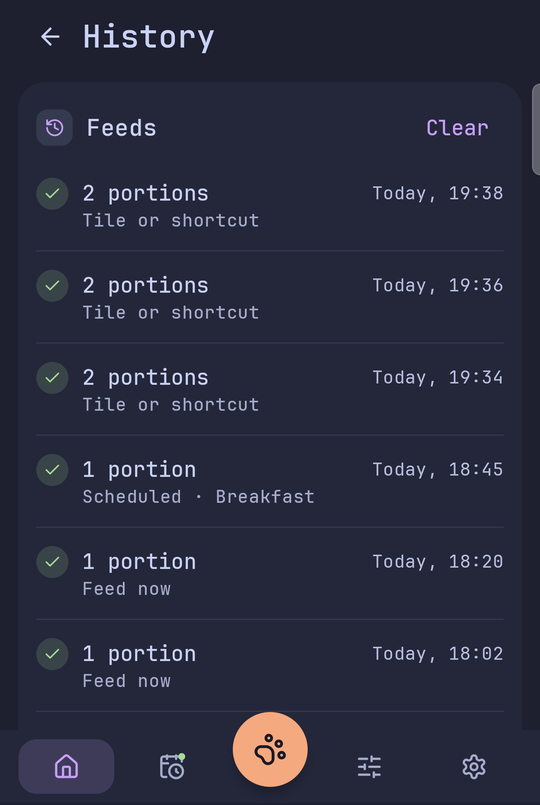

# PetBro

A native Android companion for Petlibro feeders: feed with one tap, set your own meal schedule, and see how often your pet ate today. It's built for the **One RFID Smart Feeder (PLAF301)** and talks to Petlibro's US cloud the same way the official app does.

Not affiliated with Petlibro.

<p align="center">
  <a href="docs/screenshots/1-feeder.png"></a>
  <a href="docs/screenshots/2-feed-now.png"></a>
  <a href="docs/screenshots/3-schedule.png"></a>
  <a href="docs/screenshots/4-configure.png"></a>
  <a href="docs/screenshots/5-settings.png"></a>
  <a href="docs/screenshots/6-history.png"></a>
</p>

## How it works

- **Sign in** with a US Petlibro account that has access to your feeder (yours, or one the feeder is shared with). The password is sent once to get a session and never stored; the session token is encrypted with an Android Keystore key.
- **Requests:** plain HTTPS calls to `api.us.petlibro.com`, the same endpoints the Petlibro app uses. They're not a public API, so a Petlibro change can break them.
- **Tabs** along the bottom: Feeder, Schedule, Configure and Settings, with the paw button in the middle. History opens from the clock button in the Feeder header, or from the Meals card.
- **Starts instantly:** the devices, today's numbers, feeder details and settings from last time show at once, while a quiet check runs in the background (the refresh button spins; a note says if Petlibro couldn't be reached).
- **Private:** PetBro blocks screenshots and hides its screen in the recent-apps view, since it shows your account and feeder.

## Feed now

- **Tap the paw** in the middle of the tab bar to feed straight away. It buzzes, spins while the request is out, and gives a double buzz and a message once Petlibro accepts it.
- **Hold the paw** to change how many portions a tap gives (1–48), or to dispense now.
- The paw is greyed out until you're signed in with a feeder picked.
- The same amount is used by the Quick Settings tile, the launcher shortcut and automation, and can be set under **Settings → Quick feed**.

## Schedule

The Schedule tab has one switch to feed automatically, then a card per meal.

| Option | Choices |
|---|---|
| Repeats | Daily, weekly on chosen days, or monthly on a day (or the last day) |
| Time | A clock-dial picker, following the phone's 12- or 24-hour setting |
| Portions | 1–48 per meal |
| Meals | As many as you like (**Add meal**), each with its own name (the pencil), on or off, and removable |

With two or more meals, the top card says which comes next. Warnings show there if you're signed out, battery optimization could hold meals back, or Alarms & reminders is off, each with a **Fix** button.

Meals run on exact alarms, so they go out on time with the app closed, and are set again after a reboot or clock change. A meal that comes more than 5 minutes late (the phone was off, say) is skipped rather than served late. Each scheduled meal posts a notification: the portions when it's served, or an error saying why it didn't go out. Turning the schedule on asks for the app to be exempt from battery optimization, so Doze doesn't hold meals back.

The schedule runs on the phone: the phone has to be on and online at meal time.

## Feeder tab

- **Header:** the clock button opens History; the sun/moon flips light and dark.
- **Feeder:** the feeder, its model and whether it's ready. Tap it for its details (below). With several PLAF301s on the account, pick the one PetBro feeds from there.
- **Meals:** the next meal, how often your pet ate today and for how long (e.g. *Ginny ate today: 7 times · 18 min*), and the last feed. Each row opens the Schedule or History.
- **Account:** who's signed in, and sign out (the arrow in the corner).

**Feeder details** (tap the feeder): connection, food level, dispenser, lid, the Petlibro schedule, backup battery, Wi-Fi network and signal, desiccant (with *Overdue* when it's past due), today's meals and portions, the pets on the feeder, and the model, firmware, hardware, serial and MAC address. The edit button names the feeder in PetBro only; Petlibro keeps its own name.

The eating numbers come from the feeder's RFID counts. Petlibro reports how many times and how long the pet ate today, not when.

## Configure

The feeder's own settings, changed on the feeder through Petlibro:

| Group | Settings |
|---|---|
| Petlibro schedule | The feeding plan kept on the feeder, on or off (with PetBro's schedule on too, both feed) |
| Lid | Opens for your pet, stays open or stays closed; close speed; close after 1–10 seconds; open it now |
| Sound and light | Allow sound and Sound, volume, Allow light and Light (Petlibro has a master switch and an on/off switch for each) |
| Display | Screen on or off, and an icon (heart, dog, cat, elk) or a few letters of text |
| Safety | Child lock |
| Desiccant | Change every 1–60 days, and reset the countdown after a change |
| Petlibro notifications | Low battery, power change, outlet blocked and refill reminders, shown on or off (read only: there's no known way to change them outside the Petlibro app) |
| Firmware | The version, whether an update is waiting, and installing it, with its progress |

Changes go out as you make them, with no save button: switches and choices on the tap, volume when you let go of the slider, steppers half a second after the last tap, and display text when you tap **Show this text**. A change Petlibro refuses switches back, with a message. The last settings read show at once while fresh ones load (the refresh button beside light/dark spins).

## History

Opened from the clock button in the Feeder header, or the Meals card. Every meal, newest first:

- **From PetBro:** the app, the schedule, the tile, shortcut, widget and automation, with whether Petlibro accepted it (and why not). Kept on the phone (the last 200).
- **From the feeder's own record** of the last week: meals from the Petlibro app, Petlibro's schedule or the feeder's button. A feeder record within three minutes of a PetBro feed of the same size is that feed, so nothing shows twice.

"Last feed", today's counts and the widget include both. **Clear** empties PetBro's own list; the feeder's record still shows.

## Feeder alerts

Under **Settings → Feeder alerts** (on by default), PetBro checks the feeder about every half hour and notifies you when something new goes wrong: it's **offline**, **low on food**, its **lid is blocked**, or it reports an **error** (a stuck rotor, say, with the feeder's own message). Each problem notifies once when it starts. **Desiccant reminders** can be added (off by default). The check survives a reboot and stops when you sign out.

## Widget

A home-screen widget that feeds on a tap. It changes with its size:

| Size | Shows |
|---|---|
| Small | The paw and the portions a tap gives |
| Medium | The last feed's time, and *Tap to feed* |
| Large | That, plus today's feeds, how often your pet ate, and the next meal |

Each widget sets its own portions when it's placed (or from its long-press menu). The look is shared by every widget: match the app's theme or pick one, dark mode (App, System, Light or Dark), background opacity, show the last feed or just the paw, and whether a tap feeds or opens the app. These are also under **Settings → Widget look**. It redraws after every feed, schedule or theme change, re-reads your pet's numbers every 30 minutes, draws its text in the app's font, and gets Nuked's scanlines in dark.

## Tile, shortcut and automation

These feed the quick-feed amount with no confirmation.

- **Quick Settings tile:** add *Feed now* from the Quick Settings editor. It shows the portions, and *Feeding…* while a request is out.
- **Shortcut:** long-press the app icon.
- **Tasker and MacroDroid:** turn on **Settings → Automation → Allow automation apps** (off by default, so no other app can feed your pet unasked), then send a broadcast intent:

| Field | Value |
|---|---|
| Action | `local.petlibrocompanion.action.FEED_NOW` |
| Package | `local.petlibrocompanion` |
| Class | `local.petlibrocompanion.FeedNowReceiver` |
| Extra (optional) | `portions`, an integer from 1 to 48 |

Taps on the widget, tile and shortcut give one buzz. PetBro runs in the background for these, where Android drops ordinary vibrations, so they use notification vibration (no notification is shown); with notification vibration off, they're silent.

## Settings

- **App theme:** System, Light or Dark, with **AMOLED black** (pure black backgrounds in dark) and **Ultra AMOLED** (black cards too). Twelve themes, each with a light and dark version, picked from a sheet:

| Theme | Light | Dark |
|---|---|---|
| Catppuccin | Latte | Macchiato |
| Cyberpink | Corpo Plaza | Night City |
| Dracula | Alucard | Dracula |
| Gamer | LAN Party | All-Nighter |
| Gruvbox | Sun-Faded | Retro Groove |
| Halloween | Pumpkin Patch | Witching Hour |
| Midnight | Crimson Dawn | Blood Moon |
| Nord | Snow Storm | Polar Night |
| Nuked | Atomic Age | Terminal, with CRT scanlines and a vignette |
| Ocean | Shallows | Deep Sea |
| Plum | Plum Blossom | Plum Wine |
| Synthwave | Sunset Drive | Midnight Drive |

  The sun/moon in each header flips light and dark; long-press it to follow the system.
- **Feedback:** haptics on or off: ticks on toggles, choices and steppers, a buzz when feeding.
- **Quick feed:** the portions a tap on the paw, the tile, the shortcut and automation give.
- **Feeder alerts**, above.
- **Widget look** and **Automation**, above.

Everything is in JetBrains Mono, and times follow the phone's 12- or 24-hour setting.

## Code

| File | What it holds |
|---|---|
| `MainActivity.kt` | Compose UI: the tabs, Feed Now, the Feeder tab and its details sheet, Schedule, History and Settings |
| `Configure.kt` | The Configure tab: the feeder's own settings |
| `Components.kt` | Shared controls: cards, switches, pill selectors, steppers, the theme picker and the clock dial |
| `Petlibro.kt` | Petlibro's API calls (sign-in, devices, feeding, the feeder's meal record, today's numbers, pets, details, settings, problems and firmware), and the Keystore-encrypted session with everything it caches |
| `Feeder.kt` | Account state, sign-in and background checks, feeding, the feed history (merged with the feeder's record) and meal notifications |
| `Schedule.kt` | Meals, the exact alarm that serves them, and the receiver that resets it after a reboot |
| `FeedNow.kt` | The tile, shortcut activity and automation receiver, and the key that keeps other apps from feeding |
| `FeedWidget.kt` | The widget, its tap, its settings page and shared look |
| `Prefs.kt` | App preferences: haptics, quick-feed portions, automation |
| `Theme.kt` | Palettes, theme families and the type scale |
| `Alerts.kt` | Feeder alerts: the half-hourly check and its notifications |
| `Haptics.kt` | Vibration patterns |
| `LucideIcons.kt` | Lucide icons |

## Credits

- Petlibro API calls follow the [Home Assistant Petlibro integration](https://github.com/jjjonesjr33/petlibro).
- UI font: [JetBrains Mono](https://github.com/JetBrains/JetBrainsMono) (SIL Open Font License 1.1).
- Palettes: [Catppuccin](https://catppuccin.com), [Dracula](https://draculatheme.com) and Alucard, [Gruvbox](https://github.com/morhetz/gruvbox), [Nord](https://www.nordtheme.com) and more.
- Icons: [Lucide](https://lucide.dev) (ISC License).

## Building

Uses Android Studio's bundled JDK and the Android SDK (`~/Android/Sdk`).

```bash
JAVA_HOME=/opt/android-studio/jbr ./gradlew assembleRelease
```

The APK lands in `app/build/outputs/apk/release/`. Install it with `adb install -r app/build/outputs/apk/release/app-release.apk`.

Builds are signed with `petbro-debug.p12` in the project folder when it's there (it's kept out of git), so updates install over the first PetBro and keep its sign-in; otherwise they use the usual debug key.
